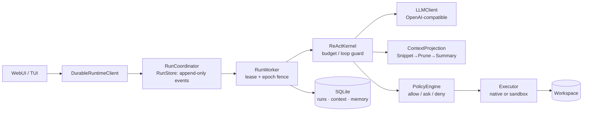

# cc-harness

[](https://github.com/liyanxiong278176/cc-harness/actions/workflows/core.yml)

本地运行的 coding agent：在选定项目目录里读写文件、执行命令、跑测试，并在浏览器 WebUI 里对话与审阅。
核心是一条 **Durable Runtime**（事件溯源 + 租约 + 可恢复执行），外围是上下文压缩、分层记忆、权限闸门与输出 DLP。

> 定位：单用户、本地、可审计的编程代理。**不是**多租户沙箱，也**不是**"无人值守跑任意外部代码"的运行时。

## 三个可复核的数字

| 评测 | 结果 | 口径 |
| --- | --- | --- |
| Terminal-Bench 2.1 | 89 任务 × 5 trials，**72/89 任务至少一次通过**（80.9%） | Harbor 本地执行，非官方 leaderboard 提交 |
| AgentDojo v1.2.2（500 trials） | 攻击成功 **0/306**；工具效用 74.8%（受攻击组）/ 87.1%（良性组） | 冻结子集，**带权限闸门**，不能与无审批榜单直接比较 |
| LoCoMo（1,986 QA） | 官方确定性 F1 **0.606**；分层记忆比完整历史注入省 **57.3%** 输入 token | 准确率 20/24 vs 24/24：省 token，但**没有**更准 |

机器汇总见 [`docs/eval-evidence/`](docs/eval-evidence/README.md)，口径与失败样例见
[评测方法](docs/eval-methodology.md)。所有结果均为单机、单模型（`deepseek-v4-flash`）可重复运行。

## 架构



一次任务的主链路：

1. `entrypoint` 解析参数 → `DurableRuntimeClient.submit()` 写入 `RunCreated/RunQueued`。
2. `LocalSupervisor` 选可运行的 run → `RunWorker.claim()` 拿 lease（带 epoch，过期提交会被拒）。
3. 每个 segment：重建投影 → 压缩上下文 → 调模型 → 工具动作经 `PolicyEngine` → 落事件。
4. 崩溃/中断后从事件日志恢复；工具结果不确定时记 `OUTCOME_UNKNOWN` 并要求显式对账，而不是盲目重放。
5. WebUI 只读事件流，不拥有第二套执行引擎。

更细的图与状态机见 [runtime 全景](docs/agent-runtime-full-flow.md)、[任务执行内核](docs/task-execution-kernel.md)、
[租约模型](docs/runtime-leases.md)。

## 快速开始

要求 Python 3.11+。

```powershell
python -m pip install -e .
cc-harness                     # 启动 WebUI（默认 http://127.0.0.1:3080/）
cc-harness --no-open --port 3080
```

首次运行需要 `.env`（`OPENAI_API_KEY` / `OPENAI_BASE_URL` / `OPENAI_MODEL`）。
模型与执行后端的选择写在 `policy.yaml`，默认执行后端是 OpenSandbox，Docker 不可用时按 profile 决定是否降级
（`standard` 降级到 host 并审计，`hardened` / `benchmark-one-shot` 直接失败）。

### 测试

```powershell
python -m pip install -e '.[dev]'
python -m pytest tests -q            # 核心套件；agentdojo 相关用例自动 skip
python -m ruff check cc_harness/ tests/
```

`agentdojo` 是可选基准依赖（`pip install -e '.[benchmarks]'`），缺失时相关用例 skip 而不是让整套收集失败。
评测复现：`python scripts/run_cc_only_benchmark.py --help`。

## 安全模型（能力边界，先写清楚）

- **权限闸门是单点的**：`allow / ask / deny` 三档 + 工作区外路径与凭据路径的 **hard-deny**（参数递归检查，
  换 key、嵌套都不放过）；allowlist 只影响会话内重复询问，绕不过 hard-deny。
- **参数来源可追溯**：`cc_harness/security.py` 是确定性实现（无模型调用），高风险动作要求参数值能追溯到用户请求。
- **输入/输出两层过滤**：L2 拦注入（正则跑全文 + 双 judge），L5 对模型主动产生的文本做密钥/PII 脱敏并落审计。
- **仓库不能给自己松绑**：`policy.yaml` 随仓库走，因此工作区内的 policy 只能收紧、不能关闭 L2/L5/闸门或把
  executor 降级成 native；要覆盖需显式 `CC_HARNESS_TRUST_WORKSPACE_POLICY=1`。
- **工具输出有上限**：`ToolResult` 边界统一 head/tail 截断（默认 128K 字符，`CC_HARNESS_MAX_TOOL_CHARS` 可调），
  避免一次 10MB 输出把事件日志和后续 prompt 一起拖垮。
- **它不是内核沙箱**：native 模式下子进程可以访问宿主文件系统；"凭据不可达"仅指环境变量剥离，
  不等于文件 ACL。需要在不可信仓库上跑时请用 `hardened` profile 并确保沙箱可用。

取舍与已知边界见 [已知边界](#已知边界)，安全评测数据见上表。

## 目录

```text
cc_harness/
  entrypoint.py      # 唯一入口：durable runtime
  durable_repl.py    # 终端交互层：只调 durable 客户端，无模型循环
  durable_runtime.py # 模型适配 + 工具执行 + 事件投影
  worker.py          # RunWorker：claim → segment → 工具 → 落事件
  run_store.py       # append-only 事件存储、lease/epoch 校验
  run_kernel.py      # ReAct 内核（预算、循环守卫）
  context.py         # 三级压缩 + 可重建投影 + 压缩后回查
  memory/            # L0-L3 分层记忆、遗忘/epoch 治理
  policy.py          # allow/ask/deny 闸门
  security.py        # 确定性参数 provenance
  executor.py        # 命令执行加固（cwd/env/timeout/进程树）
  sandbox.py         # OpenSandbox 容器后端
  agent.py           # ⚠ eval-only：LoCoMo 适配器专用引擎，产品不得 import
tests/               # 单元 + 契约 + 故障注入
eval/                # Terminal-Bench / AgentDojo / LoCoMo 适配器与结果
docs/                # 设计、ADR、审计报告、评测口径
```

## 已知边界

- **单用户本地**：没有多租户隔离；`policy.yaml` 与 `mcp.json` 仍从工作区读取
  （policy 已限制为"只能收紧"，`mcp.json` 里的 server 仍等于用户信任的代码）。
- **记忆是"可追溯、可删除"，不是"不可污染"**：工具观察里的文本可能进入 L1 事实；L5 不扫描工具观察。
- **自动注入只到 L3 画像**：L1/L0 需要模型显式调用 `memory_recall`，且当前只在 chat/qa 模式提示。
- **引擎已收口，但 eval 侧还留着一个**：产品只有 Durable Runtime（`entrypoint` → `durable_runtime` → `worker`），
  `repl.py` / `runtime.py` / `tui/` / `project/subagent.py` 已删除；`cc_harness/agent.py` 是 **eval-only**
  引擎，只被 LoCoMo 适配器使用（改它会重新基线已发布的数字）。边界由 `tests/test_single_runtime.py` 与
  `python scripts/legacy_engine_inventory.py --check` 强制（product_refs 必须为 0），剩余计划见
  [迁移文档](docs/runtime-legacy-migration.md)。
- **压缩会保留原文引用**：摘要丢失的细节可通过 `read_ref` 回查，但摘要本身没有保真度评测。
- **judge 只看头尾**：超长输入的正则层跑全文，但语义 judge 只判 head+tail（24K 字符），
  截断会写进审计 reason（`judge_input_truncated`）。

## 文档

- 评测：[方法](docs/eval-methodology.md) / [证据](docs/eval-evidence/README.md) / [上下文质量报告](docs/local-context-memory-completion.md)
- 运行框架：[全景](docs/agent-runtime-full-flow.md) / [内核](docs/task-execution-kernel.md) / [租约](docs/runtime-leases.md) / [恢复加固](docs/runtime-recovery-hardening.md) / [legacy 迁移预算](docs/runtime-legacy-migration.md)
- 安全：[沙箱一致性](docs/sandbox-conformance.md) / [发布门禁](docs/sandbox-release-gate.md) / [能力剖面](docs/sandbox-capability-profile.md)
- 设计记录：[ADR](docs/adr/) / [specs](docs/specs/) / [审计](docs/audits/)
- 求职材料（简历口径 + 已发现的问题）：[measured 版](docs/resume-project-measured-2026-10-11.md)
- 深入阅读：[上下文压缩](docs/context-compaction-explained.md) / [长期记忆](docs/long-term-memory-explained.md) / [评测说明](eval/README.md)
