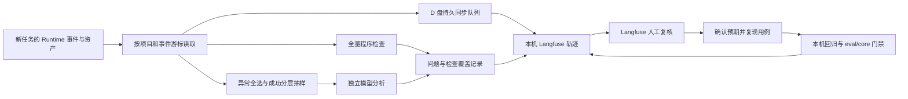

# Langfuse Agent 可观测性与评测闭环设计

日期：2026-10-25，更新：2026-10-26。状态：整体方案已获用户确认并实施；最终模型验收因提供方 HTTP 402 未完成。本文件保留设计约定，实际交付和限制见[运行手册](../observability-langfuse.md)。

关联：[ADR-0119](../adr/0119-use-langfuse-for-agent-observability-and-evaluation.md)、[领域词汇表](../../CONTEXT.md)、[统一评估证据核心](../adr/0020-own-a-unified-eval-evidence-core.md)。

## 1. 已确认范围

| 项目 | 已确认决定 |
| --- | --- |
| 问题范围 | 虚假完成、执行阻塞、上下文失效全部纳入，并沿用九个能力域扩展问题分类 |
| 组织方式 | 能力模块 → 具体问题；同一 Trace 可属于多个问题类型，每项关联步骤与证据 |
| 可信状态 | 区分已确认与待核实，保留判定来源和依据 |
| 检查覆盖 | 区分查出问题、检查后未发现问题、尚未检查；没有标签不代表通过 |
| 自动判定 | 程序确认有直接证据的问题；模型提供待核实线索；人工可确认、驳回、补充，保留修改记录 |
| 使用界面 | 在 Langfuse 查看项目总览、条件筛选、轨迹详情及评测；cc-harness 页面保持现状 |
| 部署 | 当前 Windows 电脑，Docker Compose 自托管 |
| 存储 | 本轮观测、诊断、评测的持久化数据与备份实际落在 D 盘 |
| 接入起点 | 只接启用后的新任务，不导入或补分析接入前的历史任务 |
| 分析服务 | 复用当前模型服务，独立请求，不继承 Agent 记忆，不执行工具 |
| 分析内容 | 脱敏后的完整可见轨迹，包含全部用户消息、可见回复、工具参数和结果 |
| 分析选择 | 异常任务全部分析；成功任务分层抽查，优先压缩、多次重试、中断恢复，同时随机抽查普通成功 |
| 分析用量 | 不设每日用量上限；仍限制并发、单次请求和错误重试 |
| 服务故障 | 主任务继续；本地保存待补工作，恢复后自动补传、补分析 |
| 数据保留 | 长期保留，默认不自动删除 |
| 评测闭环 | 确认问题 → 可复现用例 → 修复后冻结回归 → 自动回归 → 发布判定 |
| 首版评测集 | 30 条 Agent Golden Set 候选加 12 条流程保留任务，另复用九组无模型快检；交付初始资产、独立验证器、Langfuse 数据集与实际运行结果 |
| 门禁地点 | 当前电脑运行，结果写入本机 Langfuse |
| 门禁触发 | 提交前无模型快检；推送或发布前完整回归 |
| 放行依据 | 关键检查失败阻断；必要结果或证据缺失暂不放行；模型疑似意见不单独阻断 |

## 2. 仓库现状与复用边界

- `cc_harness/run_events.py` 已定义模型调用、工具观察、上下文投影、压缩、记忆、审批、恢复与结果事件；`run_store.py` 提供持久事件分页和 artifact 存储。
- `worker.py` 已提交 `ContextProjectionBuilt` 等事实；实际请求、完整消息和工具结果能否逐步还原，须在接入时逐项核实，不能仅凭存在事件名宣称完整捕获。
- `run_outcomes.py` 已有主失败分类、次要原因、证据引用；本轮问题标注补充多方面诊断，不替换现有结果语义。
- `eval/core` 已有任务契约、运行清单、Trial、持久 runner、发布判定和报告；`eval/native` 有九个能力域的冻结回归定义，需要核实其测试入口仍覆盖当前 Runtime。
- `eval/locomo/trace.py` 已有专项 Langfuse 封装，`pyproject.toml` 声明 `langfuse>=4.7,<5`。旧 `eval/README.md` 和 `eval/langfuse/README.md` 的“未启用”文字不能代表当前全仓库状态，也不能证明通用 Runtime 已完成接入。
- 本轮不修改 `web/src`、WebUI 页面或前端构建产物，不新增本地诊断面板、摘要和跳转控件。

执行事实继续以本地 Runtime 为准，发布事实继续由 `eval/core` 判定。Langfuse 承载观测、标注、数据集与实验展示；从 Langfuse 回收的人工标注是诊断输入，不能直接重写官方验证结果或发布判定。

## 3. 数据流与可靠同步

以稳定的 `project_id/session_id/run_id` 关联记录。一次 Runtime Run 对应一条 Trace，模型调用、工具动作、压缩、恢复与验证对应关联的 observations；任务可多轮恢复，不能每次恢复另造同一任务的重复 Trace。

新接入起点由项目启用边界与新建 Run 身份共同固定；仅在启用后追加了事件的旧 Run 仍不自动变成新任务。启用后创建的 Run 即使在离线或重启期间积累事件，也须恢复后补齐。

后台消费者只读取已提交事件和受控资产，不成为第二个 Runtime writer。观测游标、投递状态、诊断版本和待补请求保存到本轮 D 盘数据根；同步记录以事件身份、内容摘要和算法版本去重，重启不能重复计费或重复创建已完成的诊断。

Langfuse 发送、模型调用和人工标注同步均在后台运行。暂停、取消、审批等待等状态按实际语义记录，不一律归为故障；确认的 `stalled`、不可恢复失败和程序检出的异常进入分析队列。活跃卡住任务按事件截止点检查，后续继续执行时产生新的诊断版本。

遇到服务错误保留可重试状态、原因和最后成功游标；采用有限退避，耗尽本轮尝试后保留待补状态，不能无限紧密重试。主任务的本地事实写入失败仍沿用 Runtime 原有处理规则。

## 4. Langfuse 中的分类、筛选与复核

顶层能力域沿用 `eval/core/models.py::CapabilityDomain`：编码结果、Agent 循环、上下文、记忆、工具与协议、安全与隐私、可靠性与恢复、人工交互、运行保障。

首批问题目录至少覆盖工具选择错误、参数格式错误、工具超时、错误恢复不当、无进展重复、恢复后阻塞、要求未满足、证据缺失、虚假完成，以及有证据支持的上下文丢失或过期信息使用。目录版本化；不能仅凭“压缩后失败”确认压缩是根因。

Langfuse 的原生筛选提供逻辑上的“能力模块 → 具体问题”，不预设其原生页面已有可定制的两级树控件。以 Score Config、稳定名称、筛选条件与原生视图实现，不修改 cc-harness 或 fork Langfuse 前端。

官方当前文档说明 tags 创建后不能在 UI 中补改，因此固定的项目、记录类型等使用 metadata/tags，后验的问题结论与复核状态使用分类 scores，不能依赖回改 tags。参考：[Tags](https://langfuse.com/docs/observability/features/tags)、[Scores 数据模型](https://langfuse.com/docs/evaluation/scores/data-model)。

建议的数据约定：

| 对象 | 最小字段或语义 |
| --- | --- |
| Trace metadata | 项目与会话、Run、代码与配置摘要、记录 schema、任务来源、接入代次 |
| Observation | 稳定步骤身份、原事件序号、输入输出引用、实际耗时、状态、错误码、attempt、父子关系 |
| 问题记录 | issue_id、能力域、具体问题、步骤引用、证据引用、已确认/待核实、判定来源、判定器版本 |
| 检查记录 | 检查器与版本、适用范围、已覆盖步骤、发现/未发现/未完成、未完成原因 |
| 复核记录 | 对应 issue_id、确认/驳回/补充、理由、复核者、时间、关联前一版本 |
| 当前筛选投影 | 按规则计算的当前有效问题状态与覆盖，原始自动判断和历次人工意见单独保留 |

程序、模型、人工的评分名称使用不同命名空间，不能在同名字段下混合来源；当前有效问题状态用独立投影字段。一个问题类型在不同步骤发生多次时，各自保留 issue_id，Trace 层按当前有效问题汇总用于筛选。

检查覆盖应精确到已执行的检查器及其范围，运行某一个上下文检查不能代表所有上下文问题均已排除。缺少证据、分析未完成、检查不适用等原因必须可见，不能显示为“检查通过”。

人工在 Langfuse 原生标注界面与 Annotation Queues 复核，对具体问题提交新判断。复核历史采用新增记录和版本关联保留；同步程序不能仅轮询可覆盖的当前值后声称拥有完整修改历史。若固定版本的原生 UI/API 不足以表达新版本复核，先明确这个缺口，再调整映射，不能静默放弃历史或另加 cc-harness 页面。参考：[Annotation Queues](https://langfuse.com/docs/evaluation/evaluation-methods/annotation-queues)。

验收时应能在 Langfuse 完成“当前项目 + 上下文 + 已确认 + 最近七天”的筛选，点入问题后定位到原步骤与证据；同一 Trace 的工具问题也应能在工具条件下独立检索。原生文本筛选或侧栏筛选的具体表达以固定部署版本实测为准。参考：[筛选文档](https://langfuse.com/docs/observability/features/filter-search-bar)。

## 5. 全轨迹分析与抽样

记录用户可见的完整交互、工具调用与结果，以及排查所需的实际模型上下文证据。独立分析请求复用现有服务配置，不继承被测任务的会话、记忆或工具执行能力；轨迹正文始终作为待分析资料，不能作为新的执行指令。

对所有输出到观测与分析系统的副本脱敏，不原地改写 Runtime 原事实。隐藏思维链不作为本轮展示或评分对象；凭据不进入轨迹、日志或模型分析资料。脱敏导致关键依据不可见时，检查应说明证据不足。

完整轨迹超出模型窗口时按明确步骤边界分段，保留全部步骤与证据的覆盖清单，并进行跨段的全局复核。任何一段未检查、数据被脱敏到无法判断或模型响应不完整时，不能宣称已经完整排查；分析输入不能静默只截取开头、末尾或异常片段。

抽样结果由项目、Run、策略版本和稳定随机种子固定；异常选择记录原因，成功分层记录所属层，避免重复恢复时重新抽签。整体方案确认后采用的实施初值为普通成功 10%、发生压缩/多次重试/恢复的成功任务 50%，可在部署配置中调整。

程序检查覆盖每条新任务轨迹；所有异常进入模型分析队列，成功按上述分层抽查。不设每日总量上限，建议初始分析并发为 1，避免与主任务争用模型配额；分析费用与任务本身用量分开记录，提供方未返回费用时保持未知，不自行补算账单。

模型意见默认待核实，可附根因假设但不冒充确定归因。用人工复核结果按维度衡量模型与人的一致性、误报与漏报，持续校准量表；不以某次模型自评分作为校准通过依据。

## 6. 本机部署与 D 盘存储

部署基于官方 Docker Compose，自托管应用及数据库、ClickHouse、队列和对象存储共同运行；以固定版本或镜像 digest 记录可复现配置。仓库当前 Python SDK 为 4.x 范围，官方最新文档也包含更高版本示例，实施时须验证服务端与 SDK 的实际兼容组合，不直接照抄跨版本 API。参考：[官方 Compose 部署](https://langfuse.com/self-hosting/deployment/docker-compose)。

建议的可配置路径：

- 本轮诊断、同步队列、评测结果、备份及脱敏资产：`D:\agent_data\cc-harness-observability\`。
- Docker Desktop 数据盘：D 盘独立目录，例如 `D:\DockerDesktop\`；数据库 named volumes 位于该数据盘内的 Linux 文件系统。
- Compose 配置、启动与验证脚本纳入仓库；数据目录、真实密码和 API key 不提交。

路径是实施默认值，可在不改变“持久数据实际在 D 盘”约束下调整。本轮 D 盘约束针对新增观测与评测子系统和 Docker 持久数据；旧任务事实库不因接入自动迁移或回填。

只读检查发现 Docker 数据盘当前在 C 盘。实施前重新盘点 Docker 状态，采用受支持的存储位置调整方式迁至 D 盘，验证后再拉取本轮镜像和创建服务，避免先把大批数据写入 C 盘。不能通过删除或重建已有数据盘冒充迁移。参考：[Docker Desktop WSL 存储位置](https://docs.docker.com/desktop/features/wsl/)。

仅将配置文件存入 D 盘不满足验收；应核对 Docker 数据盘、各服务挂载、实际写入增长与重启后的数据存在性。长期保留意味着不配置按天自动删除；备份写到 D 盘并做恢复抽检，备份与活动数据同盘不应宣称具备磁盘损坏后的异地恢复能力。

## 7. 回归用例、基线与发布门禁

评测集是独立交付，包含任务清单、初始资产、独立验收器、Langfuse Dataset/Experiment 与试跑结果。[首版评测集设计](2026-10-25-langfuse-evaluation-dataset.md)给出了九组无模型契约、30 条 Agent Golden Set 候选和 12 条流程保留任务。实现位于 `eval/observability`；旧 v1.0.0 已尝试 42 次，修正后的 v1.1.0 仍是候选，因模型服务余额不足尚未完成真实试跑，不能冻结为发布基线。

初始复用仍有效的冻结原生契约，并补齐本轮三类重点故障的受控集成任务。虚假完成、工具失败与恢复、上下文约束保留分别应有正常、失败与恢复证据；新建受控任务明确标记为内部案例，不冒充生产失败或公开 benchmark。

新任务中经确认的问题先进入复现候选；固定输入、初始环境、权限、预期 outcome、禁止修改项与验收器，确认可复现后进入开发集。修复稳定后再冻结为回归用例，记录来源 Trace 和问题身份。真实失败记录不自动生成 gold label，也不自动进入保留集。

首个基线须审查并批准，绑定代码、模型配置、数据集版本、初始状态及判定器版本。以后与该已批准基线及固定底线比较，不能每次改用上一轮运行掩盖逐步退化。改变用例或标准须版本迁移，不能为当前实现临时放宽。

提交前执行无模型快检；推送与发布入口执行本机完整回归。Git hooks 与显式命令复用同一 runner；保留既有 hooks 并组合调用，不覆盖用户配置。发布入口本身也必须校验证据，不能仅依赖可绕过的本地 hook 后宣称发布不可绕过。实际可执行发布入口须在实施时核实并接通，缺少入口时交付明确的受门禁发布包装命令，不自动上传或发布包。

门禁复用 `eval/core` 的任务契约、运行清单、Trial 与发布判定，通过适配把任务轨迹、Dataset 和 Experiment 结果关联到 Langfuse。执行与检查在本机进行，不预设自托管实例一定具备云端托管判定器能力。

关键可核验检查失败即阻断；必要结果缺失或无效不放行；模型的待核实意见仅进入复核。环境故障与任务能力失败分别保留，重试不能覆盖旧 attempt。观测写入延迟不改写本地有效门禁结果；必要验收证据确实缺失时仍不得放行。

每次失败报告给出问题类型、退化用例、实际与预期、已批准基线及候选 Trace/步骤链接，保留未完成检查原因，不只显示一个总分。新发现的真实问题继续进入同一候选与复现流程。

## 8. 实施拆分与验收

按依赖顺序执行，已有未提交的业务改动由原工作保留，不纳入本轮前端范围。

| 阶段 | 工作 | 必须获得的证据 |
| --- | --- | --- |
| 1 | Docker D 盘存储与固定版本 Compose | 实际挂载、写入位置、服务健康、重启持久化与备份恢复抽检 |
| 2 | 新 Run 接入、游标与持久队列 | 新任务完整导入、旧任务不导入、分页不漏、重启去重、故障恢复后补齐 |
| 3 | 类型目录、程序检查与覆盖 | 一条 Trace 多类型检索，具体步骤可定位，未检查不当作无问题 |
| 4 | 独立完整轨迹模型分析 | 分层抽样可复现、全段覆盖、隔离模型请求、模型意见待核实、无每日上限 |
| 5 | Langfuse 复核与数据集 | 确认/驳回/补充可用，原判断与复核历史保留，确认用例可复现 |
| 6 | 首版评测集、本机回归与发布入口 | 九组快检复核；30 条 Golden Set 候选与 12 条保留任务的清单、夹具及独立验证器齐全，运行范围如实记录；关键失败及缺证据阻断，Langfuse 可追溯 |

有意义的验证至少覆盖：

1. 同一新任务同时暴露工具与上下文问题，两种筛选均能找到，且证据指向各自步骤。
2. 主任务结果成功但某个必需检查不满足时，不能仅凭最终文本标为验收通过。
3. 正确取消、审批等待与未知副作用状态不被粗暴归为工具失败；分析不触发任何副作用。
4. Langfuse 停机、模型报错、后台进程退出后，主任务继续，待补状态和事件游标可恢复，重复投递不重复记录有效问题。
5. 成功抽样未选中的语义检查保持未检查；模型分析中途失败不能标全轨迹已完成。
6. 通过人工复核驳回的模型线索不再出现在当前已确认问题筛选中，同时旧意见仍可追查。
7. 门禁与被检查版本一致，修改代码后旧通过记录失效；真实失败、无效环境与评测缺失的结果分开显示。
8. 不修改 cc-harness 页面；本轮数据持久化与备份在 D 盘，重启可还原；启用前的任务不被后台补扫。

验收报告须区分确定性测试、受控集成验证和真实模型验证；未运行的验证明确列出，不能把设计文字当作已交付功能。

## 9. 实施初值与当前状态

用户已整体确认并授权实施，默认数据目录为 D 盘，成功抽样为 10%/50%，跨进程分析并发为 1。原生评分的连续确认、驳回及历史保留已通过本机接口验证；开源部署使用透明的评分修订日志代理，不依赖企业版审计功能。当前服务端镜像固定 digest，Python SDK 实测为 4.17.0。修正后的候选评测集和真实模型分析尚缺完整有效试跑，发布门禁保持阻断；详见运行手册。
